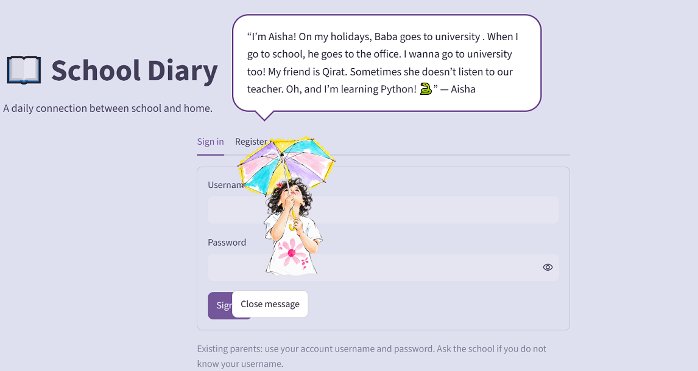
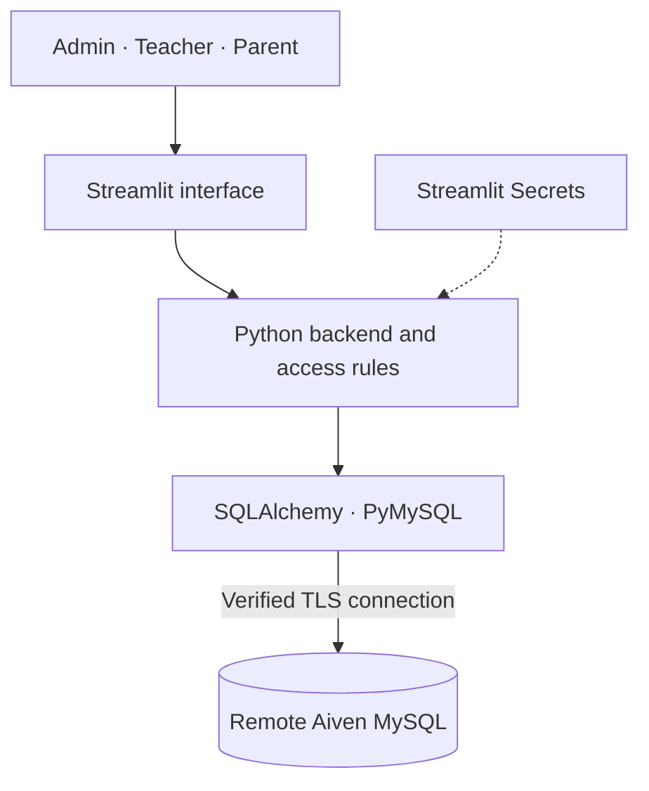

# 📖 School Diary

### A daily connection between school and home.

Inspired by **Aisha** · Developed by **Muhammad Masood Saleem**

[Open School Diary](https://school-diary.streamlit.app) · [GitHub](https://github.com/masoodsaleem-cangel) · [Contact](mailto:masoodsaleem@hotmail.com)

**Python · Streamlit · MySQL · Aiven · GitHub**

---

## The idea

A school diary that stays with you. Teachers share homework, notices and activities. Parents acknowledge them and reply. The school manages everything from one place.

One login, with access based on the account. Conversations stay private to each family, while teachers can follow the replies under the same diary entry.

## Technology & architecture

| Layer | Technology |
| :--- | :--- |
| Frontend | Streamlit, with custom HTML and CSS |
| Backend | Python, with server-side authentication and access checks |
| Database access | SQLAlchemy and PyMySQL |
| Remote database | MySQL hosted on Aiven |
| App hosting | Streamlit Community Cloud |
| Version control & deployment | GitHub connected to Streamlit Community Cloud |
| Secret management | Streamlit Secrets, kept outside the repository |

The application and SQL database are hosted separately. Diary entries, accounts, replies and acknowledgements remain in the remote database when the application is updated.

## Security

- **Password protection:** salted PBKDF2-HMAC-SHA256 with 600,000 iterations. Passwords are stored as hashes.
- **Encrypted database connection:** SSL/TLS with certificate and hostname verification.
- **Server-side secrets:** database credentials and the invitation key are supplied through Streamlit Secrets.
- **Role-based access:** Admin, Teacher and Parent permissions are checked on the backend. Parents only access their linked children’s conversations.
- **Login protection:** five failed attempts trigger a five-minute account lockout. Sessions expire after 30 minutes of inactivity.
- **Database queries:** bound parameters keep user input separate from SQL commands.

## Parent invitations

The school creates the student record and shares a short, six-digit invitation with the guardian. The parent registers using their CNIC and invitation, then chooses their own username and password.

Each invitation works once and expires after 24 hours. Generating a replacement invalidates the previous short code for that CNIC. CNICs are hashed, and invitation verification uses HMAC-SHA256 with a server-held secret, plus attempt limits.

Simple for the parent. Controlled by the school.

## Performance & indexing

- Composite indexes support class/date feeds, family replies and student lookups.
- Feeds load ten posts at a time; conversations load when opened.
- Reply and acknowledgement counts are fetched in batches.
- Repeated permission reads are reused within the same page run.
- Welcome images are resized and cached for display.
- Database connections are pooled and checked before reuse.
- The Activity Log uses pagination and manual refresh.

## Development pipeline

**Edit → Test → Commit → Push to GitHub → Automatic app update**

I make and review the changes, then commit and push them myself. Streamlit picks up the pushed changes and updates the live application—often within seconds for small changes, though startup and dependency updates can take longer.

The release is driven by my GitHub push. No AI agent commits or deploys changes as part of this pipeline. A local commit alone does not update the live app; it must be pushed to the connected branch.

---

**Muhammad Masood Saleem**  
[masoodsaleem@hotmail.com](mailto:masoodsaleem@hotmail.com) · [GitHub](https://github.com/masoodsaleem-cangel)

© 2026 Muhammad Masood Saleem. All rights reserved.

